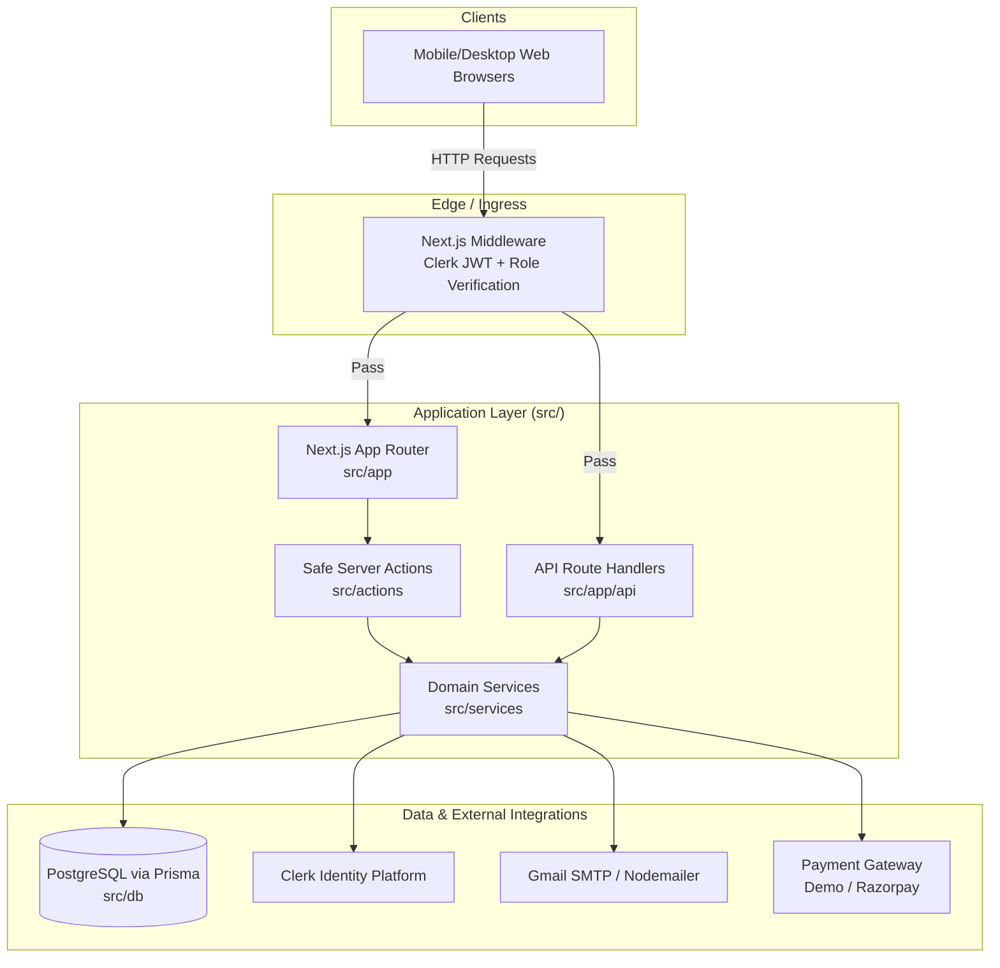
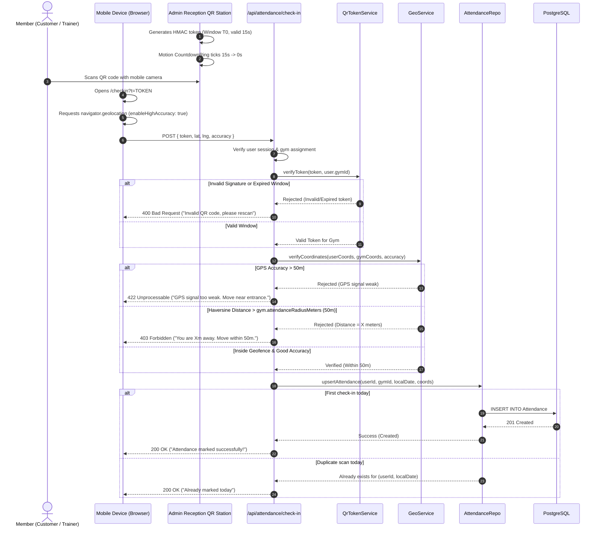

# System Architecture Specification (`docs/ARCHITECTURE.md`)

This document defines the high-level system architecture, data request flow, security/multi-tenancy isolation model, attendance verification mechanics, and provider abstractions for Gym CRM.

---

## 1. System Overview

Gym CRM is a production-grade, multi-tenant SaaS application built with **Next.js App Router**, **PostgreSQL**, and **Clerk Auth**, engineered specifically for gym owners, trainers, and customers.



---

## 2. Request Flow & Architectural Boundaries

To ensure strict separation of concerns, code is partitioned into four distinct tiers:

1. **Routing & Presentation (`src/app`, `src/features`, `src/components`)**:
   - `src/app`: Page components and route handlers only. No direct database or ORM calls.
   - `src/features`: Domain-specific components and feature hooks.
   - `src/components`: Atomic UI (`ui/`), layouts (`layout/`), micro-interactions (`motion/`), and shared widgets (`shared/`).

2. **Action Layer (`src/actions`)**:
   - Server Actions wrapped with `createSafeAction()`.
   - Validates caller authentication and extracts `userId` and `gymId` from DB session.
   - Validates incoming parameters strictly with Zod (`src/schemas`).
   - Delegates all business execution to services.
   - Returns typed `ActionResult<T>`.

3. **Domain Service Layer (`src/services`)**:
   - Framework-agnostic business logic.
   - Handles calculations (Haversine distance, trial expiry dates, salary settlement, receipt numbering).
   - Coordinates multi-step operations and orchestrates external provider calls (`PaymentProvider`, `EmailProvider`).

4. **Data Access Layer (`src/db`)**:
   - Prisma Client singleton (`src/db/client.ts`).
   - Repository functions (`src/db/repositories/*.repo.ts`) with mandatory `gymId` parameters for tenant isolation.

---

## 3. Auth & Multi-Tenancy Isolation Model

### 3.1 Role Hierarchy & Permissions
1. **`SUPER_ADMIN` (Platform Owner)**:
   - Manages all gyms.
   - Sets manual GPS coordinates (`latitude`, `longitude`) and `attendanceRadiusMeters`.
   - Invites gym owners (`ADMIN`) storing `pendingOwnerEmail`. UI provides "Resend Invite" and "Revoke Invite".
   - Can suspend/activate any gym tenant.
2. **`ADMIN` (Gym Owner)**:
   - Scoped strictly to one gym.
   - Manages gym trainers and customers.
   - Read-only display of gym GPS coordinates and radius.
   - Maximum capacity of 50 customers.
3. **`TRAINER`**:
   - Scoped to one gym.
   - Accesses assigned customers, marks attendance, views salary records.
4. **`CUSTOMER`**:
   - Scoped to one gym and assigned to exactly one trainer.
   - Accesses personal attendance calendar, checks in via QR, downloads payment receipts.

### 3.2 Dual-Tier Auth Verification & Clerk Synchronization
- **Idempotent User Synchronization**:
  ```typescript
  export async function syncUserFromClerk(clerkId: string): Promise<UserSessionContext>
  ```
  Invoked in **all environments** via:
  1. Svix-verified Clerk webhook (`/api/webhooks/clerk`) on `user.created` / `invitation.accepted`.
  2. Post-login fallback hook when an authenticated user loads the app.
- **Invitation Binding**:
  - The user's role and `gymId` are derived **strictly** from the server-side `Invitation` record matching the Clerk-verified primary email.
  - If no invitation or pending owner invite matches: the user is granted no gym membership and redirected to a dedicated `/not-invited` informational page.
  - If the email matches a gym's `pendingOwnerEmail`, the gym's `ownerUserId` is bound to the new user and `pendingOwnerEmail` is cleared.

---

## 4. Attendance Architecture & Verification Flow

### 4.1 15-Second Rotating QR Mechanics
1. Admin opens the **Attendance QR** station on gym reception tablet/display (`/admin/attendance/qr`).
2. The page renders a rotating QR encoding:
   ```
   {APP_URL}/checkin?t={HMAC_TOKEN}
   ```
   Where `HMAC_TOKEN = HMAC_SHA256(gymId + ":" + windowTimestamp, QR_TOKEN_SECRET)`.
   Window duration is `15 seconds`.
3. Motion-powered SVG countdown ring counts down from 15 to 0. Every 15 seconds, a new token is generated without database writes.
4. On submission, the server checks both the **current** and **previous** 15-second windows to tolerate scan and transmission latency (30-second total valid window).

### 4.2 Development Geolocation Simulator
To test attendance flows without physical device relocation:
- `/checkin` displays a simulator panel when `ENABLE_GEO_SIMULATOR=true`.
- Presets:
  - **At Gym Entrance (0m)**: Sets exact gym latitude and longitude.
  - **Borderline (60m away)**: Triggers radius rejection.
  - **Far Away (5km away)**: Triggers radius rejection.
  - **Weak GPS (Accuracy 120m)**: Triggers accuracy rejection.
- **Production Guardrail**: The simulator only populates form inputs; the server continues to perform full Haversine distance and accuracy validation. The application startup crashes immediately if `ENABLE_GEO_SIMULATOR=true` in `production`.

### 4.3 Sequence Diagram



---

## 5. Payment Provider & Sequential Receipts

### 5.1 Payment Provider Interface
```typescript
export interface CreatePaymentInput {
  gymId: string;
  customerId: string;
  planId: string;
  amount: number;
  currency: string;
  customerName: string;
  customerEmail: string;
}

export interface PaymentResult {
  providerPaymentId: string;
  status: "PAID" | "PENDING" | "FAILED";
  paidAt?: Date;
}

export interface PaymentProvider {
  name: "demo" | "razorpay";
  createPayment(input: CreatePaymentInput): Promise<PaymentResult>;
  verifyPayment(payload: unknown, signature: string): Promise<boolean>;
  refund(paymentId: string, amount?: number): Promise<boolean>;
}
```

### 5.2 Receipt Number Sequencing
- Format: `{receiptPrefix}-{YYYY}-{00001}` (e.g., `REC-2026-00001`).
- Atomic sequence generated via `ReceiptCounter` table `(gymId, year, lastNumber)` inside the payment transaction.
- Resets every calendar year per gym. Numbers are strictly monotonic and never reused.

---

## 6. Email Provider & Trainer Payroll

### 6.1 Email Provider Interface
```typescript
export interface EmailAttachment {
  filename: string;
  content: Buffer | string;
  contentType: string;
}

export interface SendEmailOptions {
  to: string;
  subject: string;
  html: string;
  text: string;
  attachments?: EmailAttachment[];
  replyTo?: string;
  fromName?: string;
}

export interface EmailProvider {
  name: "gmail-smtp" | "gmail-oauth";
  sendEmail(options: SendEmailOptions): Promise<{ success: boolean; messageId?: string; error?: string }>;
}
```

### 6.2 Idempotent Trainer Payroll
- `ensureSalaryRecordsForMonth(gymId, month)` executes an atomic `createMany` with `skipDuplicates: true` against `@@unique([trainerId, month])`.
- Snapshots each trainer's `monthlySalary` at generation.
- Automatically invoked:
  1. On the 1st of every month by the daily cron handler (`/api/cron/expire-memberships`).
  2. Dynamically as a fallback safeguard whenever an admin loads the salaries dashboard.
