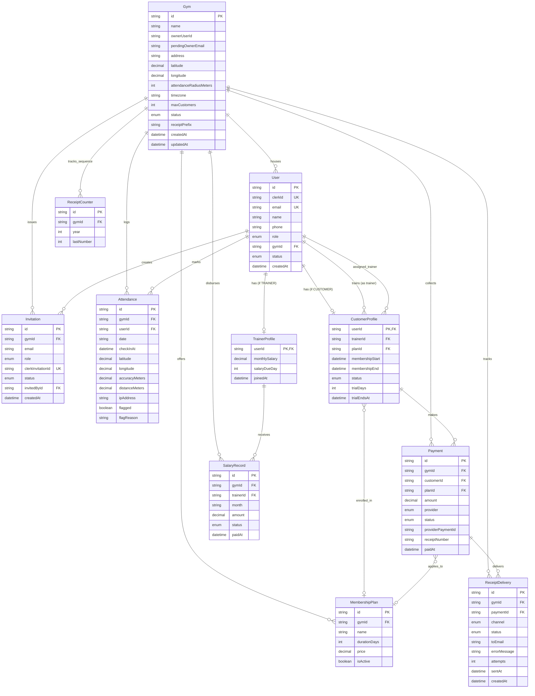

# Database Architecture & Schema Specification (`docs/DATABASE.md`)

This document outlines the multi-tenant PostgreSQL schema, entity relationships, indexing strategy, and concurrency controls implemented via Prisma ORM for Gym CRM.

---

## 1. Entity-Relationship Diagram (ERD)



---

## 2. Multi-Tenancy & Data Isolation

### Tenancy Boundary
All domain entities except `SUPER_ADMIN` platform users are strictly bounded by `gymId`.
- Every repository function in `src/db/repositories/*.repo.ts` mandates `gymId` as the primary search parameter.
- Tenant data leakage is prevented by enforcing:
  1. **Middleware verification**: Rejects requests targeting gyms not linked to the user's token.
  2. **Server Action validation**: Verifies caller `gymId` from DB session before querying resources.
  3. **Repository scoping**: Every Prisma query contains `where: { gymId }`.

---

## 3. Detailed Model Specifications

### 3.1 `Gym`
Represents a gym tenant facility.
- `latitude` / `longitude`: `Decimal(9, 6)` storing high-precision coordinates. Set **manually** by `SUPER_ADMIN`.
- `attendanceRadiusMeters`: Check-in geofence threshold (default `50`). Read-only for `ADMIN`; editable only by `SUPER_ADMIN`.
- `maxCustomers`: Tenant limit (default `50`). Enforces customer capacity.
- `receiptPrefix`: Configurable prefix for sequential receipt numbers (e.g. `REC`, `IRON-`).
- `pendingOwnerEmail`: Stores invited gym owner's email while in `PENDING_OWNER` state. Cleared upon owner sign-in.

### 3.2 `ReceiptCounter`
Maintains strictly monotonic, yearly reset receipt counters per gym.
- `gymId` + `year`: Composite unique constraint `@@unique([gymId, year])`.
- `lastNumber`: Atomically incremented inside the payment transaction.
- Formatted receipt number: `{receiptPrefix}-{YYYY}-{00001}` (e.g., `REC-2026-00001`).

### 3.3 `User` & Profiles
- Uses a polymorphic profile pattern (`TrainerProfile` and `CustomerProfile` referencing `User.id` 1-to-1).
- `User.clerkId`: External unique identifier provided by Clerk authentication.
- `User.phone`: Optional contact field stored in normalized E.164 format. Not used for transactional receipts.

### 3.4 `CustomerProfile`
- **Mandatory Trainer Assignment**: `trainerId` is non-nullable. A customer cannot exist without an assigned trainer.
- **Trial Support**: `trialDays` and computed `trialEndsAt`. If active trial expires, daily cron flips status to `EXPIRED`.
- **Membership Dates**: `membershipStart` and `membershipEnd`. Renewals extend `membershipEnd` by `plan.durationDays`.

### 3.5 `Payment` & `ReceiptDelivery`
- `receiptNumber`: Sequential identifier generated per gym. Enforced unique with `@@unique([gymId, receiptNumber])`.
- `ReceiptDelivery`: Audit log for every receipt dispatch attempt via `EMAIL` (Gmail SMTP) or browser `DOWNLOAD`. Retries and failure error messages are recorded here.

### 3.6 `SalaryRecord` & Payroll Idempotency
- Unique compound constraint `@@unique([trainerId, month])` where `month` is formatted `YYYY-MM`.
- `monthlySalary` snapshot stored in `amount` at record creation.
- Created via idempotent `ensureSalaryRecordsForMonth(gymId, month)` using `createMany` with `skipDuplicates: true`.

### 3.7 `Attendance`
- `date`: Local gym calendar date string in `YYYY-MM-DD` (adhering to `gym.timezone`, default `Asia/Kolkata`).
- **One scan per person per day**: Enforced at the database level by `@@unique([userId, date])`.
- `distanceMeters`: Calculated Haversine distance between user GPS and `gym.latitude`/`gym.longitude`.
- `accuracyMeters`: Reported mobile browser GPS accuracy. Must be `<= 50m` to qualify.
- `ipAddress`: Captured solely for audit purposes; **never** used for location inference.

---

## 4. Indexing Strategy & Performance Plan

| Table | Index Columns | Index Type | Query / Access Pattern |
| :--- | :--- | :--- | :--- |
| `Gym` | `(status)` | B-Tree | Super admin filtering active vs suspended gyms. |
| `Gym` | `(pendingOwnerEmail)` | B-Tree | Resolving gym owner upon first Clerk sign-in. |
| `ReceiptCounter` | `(gymId, year)` | Unique Compound | Atomic sequence increment inside payment transaction. |
| `User` | `(clerkId)` | Unique B-Tree | Post-auth session lookup in middleware and safe-action wrapper. |
| `User` | `(email)` | Unique B-Tree | Invitations reconciliation and sign-in match. |
| `User` | `(gymId, role, status)` | Compound B-Tree | Admin people dashboard filtering (active trainers / customers). |
| `Invitation` | `(gymId, status)` | Compound B-Tree | Listing pending invites and calculating gym capacity. |
| `Invitation` | `(clerkInvitationId)`| Unique B-Tree | Clerk invitation webhook resolution. |
| `CustomerProfile` | `(trainerId)` | B-Tree | Trainer portal filtering assigned customers. |
| `CustomerProfile` | `(status, membershipEnd)` | Compound B-Tree | Expiration cron job querying overdue active subscriptions. |
| `CustomerProfile` | `(status, trialEndsAt)` | Compound B-Tree | Expiration cron job querying expired trials. |
| `Payment` | `(gymId, receiptNumber)` | Unique Compound | Receipt lookup by human-readable reference number. |
| `Payment` | `(gymId, paidAt)` | Compound B-Tree | Monthly revenue calculations on admin dashboard. |
| `Attendance` | `(userId, date)` | Unique Compound | Fast upsert / duplicate check on check-in scan. |
| `Attendance` | `(gymId, date, checkInAt)`| Compound B-Tree | Live attendance feed polling (`/api/attendance/today`). |
| `SalaryRecord` | `(trainerId, month)` | Unique Compound | Prevents duplicate salary disbursements per month. |

---

## 5. Concurrency & Transaction Guarantees

### 5.1 Enforcing 50-Customer Gym Limit
To avoid race conditions when multiple customer invitations are sent simultaneously:
```typescript
await prisma.$transaction(async (tx) => {
  const activeCount = await tx.customerProfile.count({
    where: { user: { gymId } },
  });
  const pendingInvites = await tx.invitation.count({
    where: { gymId, role: "CUSTOMER", status: "PENDING" },
  });

  const gym = await tx.gym.findUniqueOrThrow({ where: { id: gymId } });

  if (activeCount + pendingInvites >= gym.maxCustomers) {
    throw new CapacityExceededError(
      `Gym customer capacity (${gym.maxCustomers}) reached.`
    );
  }

  // Create invite or customer record safely within transaction
});
```

### 5.2 Atomic Receipt Sequence Generation
Receipt numbers are generated in the same transaction as the payment record:
```typescript
await prisma.$transaction(async (tx) => {
  const counter = await tx.receiptCounter.upsert({
    where: { gymId_year: { gymId, year } },
    update: { lastNumber: { increment: 1 } },
    create: { gymId, year, lastNumber: 1 },
  });

  const formattedSeq = String(counter.lastNumber).padStart(5, "0");
  const receiptNumber = `${gym.receiptPrefix}-${year}-${formattedSeq}`;

  return tx.payment.create({
    data: {
      gymId,
      customerId,
      planId,
      amount,
      provider,
      status: "PAID",
      receiptNumber,
    },
  });
});
```
